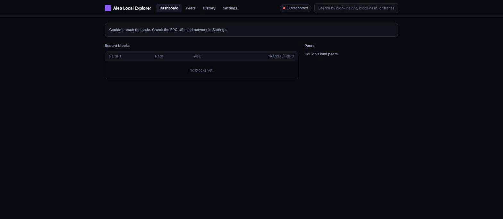

# Aleo Local Explorer

A block explorer for your own local Aleo devnet node — point it at your
node's RPC address and browse blocks, transactions, and peers.



Live, hosted version: **https://hex-aragon.github.io/aleo-local-explorer/**

It's a static site with no backend of its own — it talks directly to
whatever Aleo node you point it at (default `http://localhost:3030`,
network `testnet`), straight from your browser. That works because the
node's REST API allows cross-origin requests from any origin, and browsers
treat `localhost`/`127.0.0.1` as safe to call from an HTTPS page. So you can
use the hosted link above against your own local node — nothing to install
to get started.

## Project layout

- **`frontend/`** — the explorer itself (React + Vite + Tailwind). This is
  what's deployed to GitHub Pages.
- **`indexer/`** — an *optional* local service you can run yourself for
  block-history persistence beyond what your node can serve live. See
  [`indexer/README.md`](./indexer/README.md).

## Running the explorer locally

```
cd frontend
npm install
npm run dev
```

Open the printed local URL, then go to **Settings** and point it at your
node's RPC URL and network name if they differ from the defaults.

## Running your own Aleo devnet

Any local Aleo devnet whose REST API is reachable at the address you
configure in Settings will work — snarkOS nodes expose this via the
`--rest` flag (e.g. `--rest 0.0.0.0:3030`). Refer to
[snarkOS](https://github.com/ProvableHQ/snarkOS) for devnet setup.

## Deploying

Pushing to `main` with changes under `frontend/` builds and deploys the
site to GitHub Pages via `.github/workflows/deploy.yml`.
